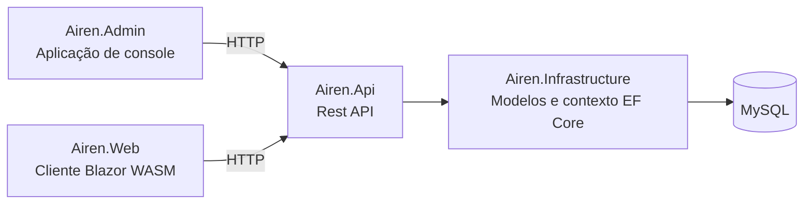

# Airen

Airen é uma solução para organizar e administrar o universo de personagens, relações e elementos narrativos de um universo ficcional.

O repositório é dividido em quatro projetos. Cada projeto possui uma responsabilidade própria, mas todos participam do mesmo fluxo: uma interface solicita uma operação, a API aplica o contrato e as regras da aplicação, e a infraestrutura consulta ou altera o banco de dados.

## Visão geral da arquitetura



As dependências entre projetos são:

```text
Airen.Admin -> Airen.Api -> Airen.Infrastructure -> MySQL
Airen.Web   -> Airen.Api
```

Na prática, a API é o ponto central de execução. `Airen.Admin` já possui fluxos de administração que consomem endpoints HTTP. `Airen.Web` está preparado como cliente Blazor, mas ainda contém principalmente a estrutura inicial do template e não implementa os fluxos do domínio.

## Projetos

### Airen.Infrastructure

É a camada de persistência e representação do domínio. Sua motivação é concentrar o que descreve os dados e como eles são armazenados, evitando que controllers e interfaces precisem conhecer detalhes do banco.

Responsabilidades principais:

- Define os modelos `Personagem`, `Potentia`, `Afiliacao`, `Capitulo`, `Habilidade`, `Hobby`, `Parentesco`, `Tecnica`, `Versao` e `Volume`.
- Disponibiliza o `AirenContext`, com um `DbSet` para cada entidade.
- Configura o Entity Framework Core e os relacionamentos entre as entidades.
- Mantém as migrations usadas para versionar a estrutura do banco.
- Permite o uso de carregamento preguiçoso por meio dos proxies do EF Core.

O relacionamento de `Parentesco` é configurado com duas referências a personagens (`Personagem` e `Parente`). As exclusões usam `Restrict` para evitar que apagar um personagem remova relações dependentes de forma inesperada.

### Airen.Api

É o backend HTTP da solução. Sua motivação é oferecer uma fronteira única e estável para qualquer cliente, escondendo a persistência e centralizando as operações do domínio.

O funcionamento lógico de uma requisição é:

1. Um cliente envia uma requisição para a rota de um controller, como `/Personagem`.
2. O controller recebe os dados e identifica a operação CRUD solicitada.
3. O serviço da entidade executa a consulta ou alteração usando o `AirenContext`.
4. Os métodos de extensão fazem o mapeamento entre DTOs e modelos persistidos.
5. O controller devolve a resposta HTTP, normalmente `Ok`, `CreatedAtAction`, `NotFound` ou `NoContent`.

Há controllers e serviços para as entidades principais. O `Program.cs` registra o contexto com MySQL, os serviços da aplicação e os controllers. A conexão é lida da chave `AirenConnection` em `appsettings.json`.

Os endpoints seguem o padrão REST:

```text
GET    /{recurso}       lista os registros
GET    /{recurso}/{id}  busca um registro
POST   /{recurso}       cria um registro
PUT    /{recurso}/{id}  atualiza um registro
DELETE /{recurso}/{id}  remove um registro
```

Exemplos de recursos: `Personagem`, `Potentia`, `Habilidade`, `Hobby`, `Parentesco`, `Tecnica`, `Versao`, `Volume`, `Afiliacao` e `Capitulo`.

### Airen.Admin

É uma aplicação de console voltada à administração manual dos dados. Sua motivação é oferecer uma ferramenta direta para cadastrar e manter o conteúdo enquanto uma interface web mais completa ainda está sendo construída.

O programa inicia em `PersonagemCore`, exibe um menu e encaminha a escolha para o fluxo correspondente. Os fluxos de criação usam `HttpClient` para chamar a API; interfaces e serviços internos organizam a navegação e as telas de console. O mesmo padrão é usado para operações relacionadas a personagens, habilidades, hobbies, potentias, técnicas e versões.

Como o Admin acessa a API por HTTPS local, `GenerateHttpHandler` configura o `HttpClientHandler` para aceitar o certificado de desenvolvimento. Isso é conveniente para o ambiente local, mas deve ser revisto antes de qualquer uso em produção.

### Airen.Web

É o cliente web em Blazor WebAssembly. Sua motivação é oferecer uma interface visual para consulta e edição do universo Airen, acessível pelo navegador e capaz de consumir a mesma API usada pelo Admin.

Atualmente ele está em fase inicial:

- `Program.cs` inicializa o Blazor WebAssembly e registra um `HttpClient`.
- A página inicial ainda é a tela padrão de boas-vindas.
- A página `Weather` é um exemplo do template e consulta `sample-data/weather.json`.
- Ainda não existem páginas de domínio conectadas aos endpoints de personagens e demais entidades.

Portanto, o fluxo pretendido é `Airen.Web -> Airen.Api`, mas a implementação dos recursos de negócio no Web ainda precisa ser feita.

## Modelo lógico do domínio

O catálogo é composto por entidades de conteúdo e entidades de organização. `Personagem` é o núcleo das relações: pode possuir habilidades, hobbies, técnicas, potentias, afiliações e parentescos. `Volume`, `Capitulo` e `Versao` organizam o conteúdo narrativo e suas versões. Os DTOs da API representam os dados expostos aos clientes sem obrigar as interfaces a usar diretamente as entidades do banco.

## Como executar

### Pré-requisitos

- .NET SDK 10.
- MySQL acessível pela aplicação.
- Uma connection string chamada `AirenConnection` em `Airen.Api/appsettings.json` ou no ambiente de execução.

Exemplo:

```json
{
	"ConnectionStrings": {
		"AirenConnection": "server=localhost;user=root;password=senha;database=airen_db"
	}
}
```

### API

```bash
dotnet run --project Airen.Api/Airen.Api.csproj
```

Para criar ou aplicar migrations:

```bash
dotnet ef migrations add NomeDaMigration --project Airen.Api/Airen.Api.csproj
dotnet ef database update --project Airen.Api/Airen.Api.csproj
```

### Admin

Com a API disponível, execute:

```bash
dotnet run --project Airen.Admin/AirenAdmin.csproj
```

### Web

```bash
dotnet run --project Airen.Web/Airen.Web.csproj
```

O Web e o Admin precisam apontar para a URL em que a API estiver executando. Antes de usar operações que alterem dados, confirme também a conexão da API com o MySQL.

## Direção da solução

O desenho atual separa bem persistência, backend e clientes. A evolução natural é concluir os componentes de domínio do `Airen.Web`, padronizar a configuração da URL da API nos clientes e ampliar os testes dos controllers, serviços e mapeamentos. Assim, o mesmo contrato REST continuará atendendo tanto a ferramenta administrativa quanto a futura interface pública.
