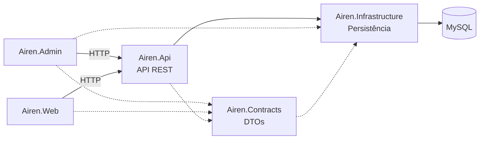

# Airen

Airen é uma solução para organizar e administrar o universo de personagens, relações e elementos narrativos de um universo ficcional.

O repositório é dividido em cinco projetos. Cada projeto possui uma responsabilidade própria, mas todos participam do mesmo fluxo: uma interface envia dados conforme os contratos compartilhados, a API aplica as regras da aplicação e a infraestrutura consulta ou altera o banco de dados.

## Visão geral da arquitetura



O fluxo de execução é `Cliente -> API -> Infraestrutura -> Banco`. Os clientes não acessam o banco diretamente: enviam e recebem JSON através da API, e os DTOs em `.Contracts` definem o formato desses payloads.

### Dependências diretas entre projetos

```text
Airen.Api          -> .Contracts, .Infrastructure
Airen.Admin        -> .Contracts, .Infrastructure
Airen.Web          -> .Contracts
Airen.Contracts    -> .Infrastructure
```

### Pacotes e tecnologias

| Projeto | Papel | Dependências principais |
| --- | --- | --- |
| `Airen.Api` | API REST | ASP.NET Core; EF Core `9.0.11`; Pomelo MySQL `9.0.0` |
| `Airen.Infrastructure` | Persistência | EF Core `9.0.11`; proxies; Pomelo MySQL `9.0.0` |
| `Airen.Contracts` | DTOs compartilhados | Referência atual para `Airen.Infrastructure` |
| `Airen.Admin` | Cliente de console | Referências para `Contracts` e `Infrastructure` |
| `Airen.Web` | Cliente Blazor WASM | Blazor WebAssembly `10.0.10`; `Microsoft.Extensions.Http` `10.0.11` |


## Projetos

### Airen.Infrastructure

É a camada de persistência e representação do domínio. Sua motivação é concentrar o que descreve os dados e como eles são armazenados, evitando que controllers e interfaces precisem conhecer detalhes do banco.

Responsabilidades principais:

- Define os modelos `Personagem`, `Potentia`, `Afiliacao`, `Capitulo`, `Habilidade`, `Hobby`, `Parentesco`, `Tecnica`, `Versao` e `Volume`.
- Disponibiliza o `AirenContext`, com um `DbSet` para cada entidade.
- Configura o Entity Framework Core e os relacionamentos entre as entidades.
- Mantém as migrations usadas para versionar a estrutura do banco.
- Permite o uso de carregamento preguiçoso por meio dos proxies do EF Core.

O relacionamento de `Parentesco` é configurado com duas referências a personagens (`Personagem` e `Parente`). As exclusões usam `Restrict` para evitar que apagar um personagem remova relações dependentes de forma inesperada.

### Airen.Contracts

É a camada de contratos compartilhados da solução. Sua motivação é separar os formatos de entrada e saída da API dos modelos persistidos, permitindo que os clientes conheçam apenas os dados necessários para consumir os endpoints.

Responsabilidades principais:

- Define DTOs de criação, leitura e atualização para as entidades do domínio.
- Mantém um formato comum de comunicação entre a API, o Admin e o cliente Web.
- Evita que os clientes dependam diretamente do `AirenContext` ou das configurações de persistência.
- Serve como referência única para os payloads enviados e recebidos pelos endpoints.

### Airen.Api

É o backend HTTP da solução. Sua motivação é oferecer uma fronteira única e estável para qualquer cliente, escondendo a persistência e centralizando as operações do domínio.

O funcionamento lógico de uma requisição é:

1. Um cliente envia uma requisição para a rota de um controller, como `/Personagem`.
2. O controller recebe os dados e identifica a operação CRUD solicitada.
3. O serviço da entidade executa a consulta ou alteração usando o `AirenContext`.
4. Os métodos de extensão fazem o mapeamento entre os DTOs de `Airen.Contracts` e os modelos persistidos.
5. O controller devolve a resposta HTTP, normalmente `Ok`, `CreatedAtAction`, `NotFound` ou `NoContent`.

Há controllers e serviços para as entidades principais. O `Program.cs` registra o contexto com MySQL, os serviços da aplicação e os controllers. A conexão é lida da chave `AirenConnection` em `appsettings.json`. Os DTOs utilizados pelos endpoints são mantidos em `Airen.Contracts`.

Os endpoints seguem o padrão REST:

```text
GET    /{recurso}       lista os registros
GET    /{recurso}/{id}  busca um registro
POST   /{recurso}       cria um registro
PUT    /{recurso}/{id}  atualiza um registro
DELETE /{recurso}/{id}  remove um registro
```

Exemplos de recursos: `Personagem`, `Potentia`, `Habilidade`, `Hobby`, `Parentesco`, `Tecnica`, `Versao`, `Volume`, `Afiliacao` e `Capitulo`.

### Airen.Admin

É uma aplicação de console voltada à administração manual dos dados. Sua motivação é oferecer uma ferramenta direta para cadastrar e manter o conteúdo enquanto uma interface web mais completa ainda está sendo construída.

O programa inicia em `PersonagemCore`, exibe um menu e encaminha a escolha para o fluxo correspondente. Os fluxos de criação usam `HttpClient` para chamar a API; interfaces e serviços internos organizam a navegação e as telas de console. O mesmo padrão é usado para operações relacionadas a personagens, habilidades, hobbies, potentias, técnicas e versões.

Como o Admin acessa a API por HTTPS local, `GenerateHttpHandler` configura o `HttpClientHandler` para aceitar o certificado de desenvolvimento.

### Airen.Web

É o cliente web em Blazor WebAssembly. Sua motivação é oferecer uma interface visual para consulta e exploração do universo Airen, consumindo a mesma API usada pelo Admin e pelo restante da solução.

A aplicação atual já conta com uma estrutura inicial funcional de navegação e apresentação de dados:

- Layout e navbar com identidade visual própria da Fundação Potentia.
- Página inicial com apresentação editorial e modal informativo.
- Rotas de navegação para `/` (home), `/personagens` e `/volumes`.
- Componentes `CardsPersonagens` e `CardsVolumes` para exibir listas vindas da API.
- Consumo de endpoints REST por meio de classes de serviço (`PersonagensAPI` e `VolumesAPI`).
- Integração com MudBlazor para UI responsiva e visual moderno.

O front-end usa `HttpClientFactory` com o nome `API` e espera a URL configurada em `Airen.Web/wwwroot/appsettings.json`:

```json
{
  "API-Server": "https://localhost:7245"
}
```

Essa configuração deve apontar para a URL em que a `Airen.Api` está rodando.

## Como executar

### Pré-requisitos

- .NET SDK 10.
- MySQL acessível pela aplicação.
- Uma connection string chamada `AirenConnection` em `Airen.Api/appsettings.json` ou no ambiente de execução.

Exemplo:

```json
{
	"ConnectionStrings": {
		"AirenConnection": "server=localhost;user=root;password=senha;database=airen_db"
	}
}
```

### API

```bash
cd Airen.Api
dotnet run
```

Para criar ou aplicar migrations:

```bash
cd Airen.Infrastructure

dotnet ef migrations add NomeDaMigration --project Airen.Infrastructure.csproj --startup-project ../Airen.Api/Airen.Api.csproj

dotnet ef database update --project Airen.Infrastructure.csproj --startup-project ../Airen.Api/Airen.Api.csproj
```

### Admin

Com a API disponível, execute:

```bash
cd Airen.Admin
dotnet run
```

### Web

A aplicação web é um projeto Blazor WebAssembly que acessa a API REST via `HttpClient` configurado em `Airen.Web/wwwroot/appsettings.json`.

```bash
cd Airen.Web
dotnet run
```

Se a API estiver rodando em outra porta, ajuste o valor de `API-Server` no arquivo `Airen.Web/wwwroot/appsettings.json` antes de iniciar a aplicação web.

Rotas principais da interface:

- `/` — página inicial com apresentação temática.
- `/personagens` — lista personagens consumindo `GET /Personagem`.
- `/volumes` — lista volumes consumindo `GET /Volume`.

O Web e o Admin precisam apontar para a URL em que a API estiver executando. Antes de usar operações que alterem dados, confirme também a conexão da API com o MySQL.
